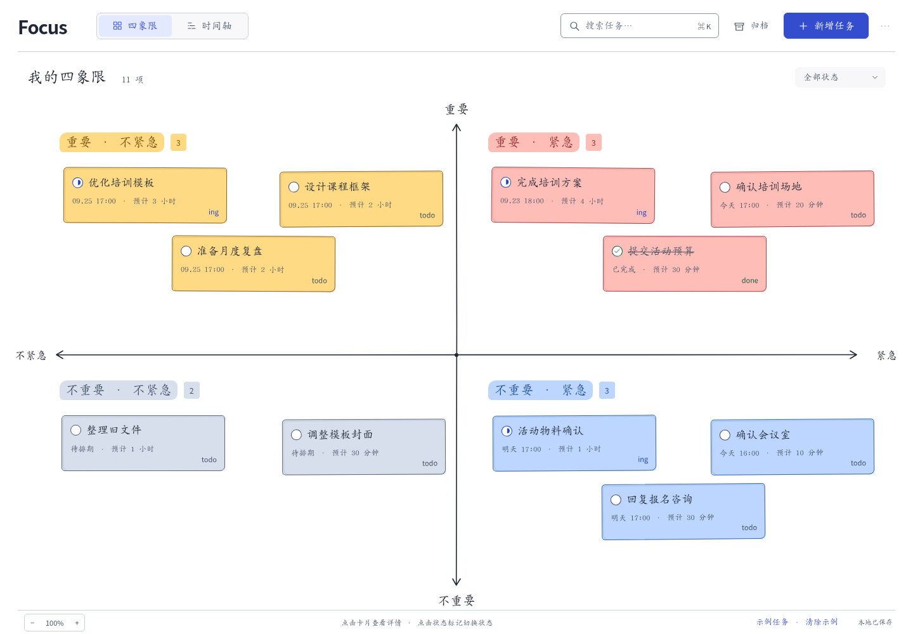

# Focus 0.1.4

本地优先的手绘四象限、甘特图与工作月历。完整 DMG 可直接拖入 Applications，无需自行编译。

## 介绍视频

[▶ 观看完整介绍视频](https://github.com/wz20/Focus/blob/main/preview/focus-demo.mp4) · 约 68 秒 · 1080p

## 下载与安装

从 [GitHub Releases](https://github.com/wz20/Focus/releases) 下载 macOS 安装包及 SHA-256 校验文件。Apple Silicon 芯片使用 arm64 包；其他架构的可用包以发布页为准。

打开 DMG，将 Focus.app 拖入 Applications。安装包使用 ad-hoc 签名，尚未经过 Apple Developer ID 签名和公证；macOS 可能提示无法验证开发者。确认下载来源后，可按系统提示在“系统设置 → 隐私与安全性”中允许打开。

## 工作月历
在「时间轴」选择「月历」。周一到周日展示整月，支持翻月和跳转月份，计划跨度和独立 deadline 分别投影到对应日期；同一天同一任务只显示一次。点击任务查看详情；点击日期展开当天任务，任务多时按需渲染、滚动查看。日期上的 + 打开已预填该日 09:00—10:00 的新增表单，可以修改或清空；不保存就不会创建任务。

状态、象限、搜索筛选与其他视图共用。todo → ing → done；done 后再次点击才归档。跨天计划覆盖相应日期，结束于午夜不占用下一天。没有计划和 deadline 的工作保留在「未安排日期」，不会擅自指定日期。月历不把计划跨度误当实际投入工时。

节假日/补班内置中国大陆 2026 年公开安排（官方转载 https://www.wuhan.gov.cn/zwgk/tzgg/202609/t20260907_2844002.shtml ），其他年份仅标注周末，不推测未来调休。

## 更新保留数据
应用标识仍为 com.focuslocal.desktop；数据仍在 ~/Library/Application Support/Focus/。
- tasks.json：任务；tasks.backup.json：上一次有效任务备份。
- reminders.json：独立提醒记录，不是任务数据库。
本次数据格式仍为 version 1，没有数据迁移，不改变旧任务字段。切换视图、翻月、筛选不写任务文件。覆盖 Focus.app 不需要重新导入数据；不要删除用户数据目录。出于备份习惯，更新前可导出一份独立 JSON。

## 既有功能保留
新增/编辑任务的四象限一次单选、todo/ing/done 和归档恢复、可选计划时间与独立 deadline、本地提醒均保留。Focus 进程运行时检查提醒；完全退出或休眠时不能准时提醒。前台页内提醒、后台请求 macOS 原生通知，系统权限和实际送达需实机确认。

## 验证范围

本次发布通过 93 项 Node 自动测试，以及 macOS Apple Silicon 原生启动、沙箱通信、任务保存、重载和时间轴冒烟测试。安装包通过 ad-hoc 签名完整性检查与 DMG 校验。测试采用独立临时数据目录。

历史浏览器验证记录见 docs 目录；本次发布未重新运行完整浏览器交互测试，系统通知送达和 Intel Mac 兼容性未在本次验证范围内。安装包尚未经过 Apple Developer ID 签名和公证。

## 源码与测试
- Node >=20：npm test
- 浏览器预览：npm run build:preview，输出 dist/Focus-preview.html
- 本机开发：npm install，然后 npm start
- 自行在 Mac 打包：bash scripts/build-mac.sh
- 浏览器测试需要 Python Playwright/Chromium；先 build:preview，再运行 tests/ui_*.py；FOCUS_QA_DIR 可指定月历截图目录。
预览 HTML 使用浏览器存储，与 Electron 数据不自动共享；正式工作请使用应用及本机 JSON 备份。

## 开源许可

Focus 源码采用 [MIT License](LICENSE)。随安装包分发的 Electron 和 Chromium 等第三方组件遵循各自许可证，相关声明保留在应用资源目录中。
